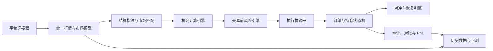

# 加密货币事件合约与衍生品套利系统：总需求设计文档

版本：0.1

研究基准日期：2026-08-15

文档用途：指导 AI 或开发团队完成需求拆分、架构设计、回测、模拟交易和受控实盘实现。

阶段性方向取舍与后续启动建议见：[09-套利方向可行性与后续实施备忘录](09-套利方向可行性与后续实施备忘录.md)。

> 本系统的目标是识别并执行可验证的价格不一致，不负责预测比特币涨跌，也不承诺收益。任何实盘功能都必须在平台资格、当地法律、API 条款和账户权限允许的范围内使用。

## 1. 项目目标

构建一套统一的套利研究与交易系统，覆盖：

1. 5 分钟、15 分钟加密货币 Up/Down 事件合约；
2. 同一事件在多个平台之间的互补结果套利；
3. 同平台完整份额套利；
4. 不同基准价但共享结算价格的覆盖套利；
5. maker 成交后自动执行第二腿对冲；
6. 现货、永续、交割合约的 Delta 中性套利；
7. 回测、纸面交易、风险控制、对账和审计。

系统必须区分以下三类机会：

- `LOCKED`：规则可证明覆盖全部结果，扣除全部成本后仍有正收益；
- `CONDITIONAL`：数学上可覆盖，但依赖尚未完全验证的平台结算一致性；
- `STATISTICAL`：依赖价差收敛、预言机相关性或波动率模型，不保证收益。

默认只允许 `LOCKED` 进入自动实盘。`CONDITIONAL` 只能进入观察或纸面交易，除非人工完成规则签核。`STATISTICAL` 默认不进入本期实盘范围。

## 2. 策略筛选结论

| 编号 | 策略 | 可行性 | 本期处理 | 设计文档 |
|---|---|---:|---|---|
| S1 | 跨平台互补结果锁利套利 | 高，但依赖规则一致 | 实施 | [01](01-跨平台互补结果锁利套利.md) |
| S2 | 同平台完整份额套利 | 高，机会频率可能低 | 实施 | [02](02-同平台完整份额套利.md) |
| S3 | 跨平台基准价覆盖套利 | 中高，需共享结算值 | 实施 | [03](03-跨平台基准价覆盖套利.md) |
| S4 | maker 成交后跨平台对冲 | 高，是 S1/S3 的核心执行方式 | 实施 | [04](04-Maker成交后跨平台对冲.md) |
| S5 | 现货＋永续资金费率套利 | 高 | 实施 | [05](05-现货永续资金费率套利.md) |
| S6 | 跨平台永续资金费差套利 | 中高 | 实施 | [06](06-跨平台永续资金费差套利.md) |
| S7 | 现货＋交割合约基差套利 | 高，但资金周转慢 | 实施 | [07](07-现货交割合约基差套利.md) |
| X1 | MEXC × Polymarket 到期互补 | 中低 | 暂不写独立实施文档 | 结算源和采样规则不同，存在双输 |
| X2 | Kalshi × Polymarket 到期互补 | 中低 | 暂不写独立实施文档 | CF Benchmarks 与 Chainlink 不同 |
| X3 | HiBT 固定赔率跨平台套利 | 低 | 暂不实施 | 无公开事件交易 API、不可提前退出、使用自身标记价 |
| X4 | TurboFlow 跨平台套利 | 中低 | 只采集研究 | 公开接口与精确结算参数不足 |
| X5 | Forsee 资金池赔率套利 | 中低 | 只采集研究 | 自身下注改变赔率，实时推送能力有限 |
| X6 | 事件合约＋永续动态 Delta 对冲 | 中低 | 只做研究指标 | 二元 Delta 临近到期和基准价时急剧变化 |
| X7 | 事件合约＋期权数字期权复制 | 低 | 只做理论定价 | 缺少完全匹配的 5/15 分钟期权到期日 |
| X8 | 期权 Box/Put-Call Parity | 中 | 暂不实施 | 多腿、保证金、结算币种和费用显著压缩机会 |

## 3. 已知平台能力基线

以下信息仅作为连接器设计基线，程序每次启动仍需重新加载平台规则和市场元数据：

| 平台 | 产品结构 | 公开自动化能力 | 结算重点 | 系统定位 |
|---|---|---|---|---|
| Polymarket | 0～1 结果份额、订单簿 | REST/SDK/WebSocket | Chainlink 30/60 秒 TWAP 数据可订阅 | 核心行情与对冲场 |
| Gate | 0～1 结果份额、订单簿 | 暂未确认事件合约正式交易 API | Chainlink TWAP，具体窗口需逐市场确认 | 观察；API 确认后接入 |
| Predict.fun | 链上结果份额 | 官方 REST/WebSocket/API | Chainlink 基础设施，数据来源和规则需逐市场确认 | 第二核心候选场 |
| Binance Wallet Prediction | Predict.fun 的访问入口 | 不视为独立流动性 | 底层为 Predict.fun | 不作为单独套利平台 |
| MEXC Prediction | 5/15 分钟 Up/Down | 暂未确认预测市场正式交易 API | 最终一分钟第三方 RTI 均价 | 统计研究数据源 |
| Kalshi | 事件订单簿 | 官方 API/WebSocket | CF Benchmarks 60 秒均价 | 统计研究数据源 |
| TurboFlow | 30 秒起 Higher/Lower | 公开事件交易接口不充分 | 需验证 Feed、窗口、平局和退出规则 | 观察 |
| HiBT | 固定赔率 | 未发现事件交易 API | 自身 USDT 合约标记价、不可提前结束 | 排除自动实盘 |
| Forsee | 资金池赔率 | REST；实时推送能力有限 | 下注会影响资金池和最终赔率 | 观察 |

官方参考：

- Polymarket：[实时数据](https://docs.polymarket.com/market-data/realtime-data)、[Chainlink TWAP](https://docs.polymarket.com/market-data/chainlink-twap)、[费用](https://docs.polymarket.com/trading/fees)
- Gate：[事件合约规则](https://www.gate.com/zh/help/event-contracts/event-faq/100550)
- Predict.fun：[开发文档](https://dev.predict.fun/)、[Chainlink 结算说明](https://predict.fun/news/predict-fun-adopts-chainlink-as-core-infrastructure-powering-high-speed-crypto-prediction-markets)
- MEXC：[Up/Down 规则](https://www.mexc.com/zh-MY/support/article/how-to-trade-up-down-crypto-events-on-prediction-markets-417522884766167040)
- Kalshi：[加密市场规则](https://help.kalshi.com/en/articles/13823838-crypto-markets)、[API](https://docs.kalshi.com/welcome)
- HiBT：[价格来源](https://support.hibt.com/hc/en-us/articles/11794328936847-How-Are-Event-Contract-Prices-Determined)、[退出限制](https://support.hibt.com/hc/en-us/articles/11794303351823-Can-an-Event-Contract-Be-Ended-Before-Expiry)
- TurboFlow：[产品介绍](https://tf.xyz/)
- Forsee：[API](https://api.forsee.market/)

## 4. 统一术语与数学模型

### 4.1 份额型二元事件

- 获胜份额到期兑付 `1`；
- 失败份额兑付 `0`；
- `ask_up(q)`：买入 q 张 Up 的实际成交均价；
- `ask_down(q)`：买入 q 张 Down 的实际成交均价。

若两腿严格互补，毛成本为：

```text
gross_cost(q) = q × [ask_up(q) + ask_down(q)]
guaranteed_payout(q) = q
```

净利润：

```text
net_profit(q)
= q
- gross_cost(q)
- trading_fees(q)
- gas_cost(q)
- expected_execution_loss(q)
- capital_cost(q)
```

只有 `net_profit(q) > safety_buffer` 才能生成候选订单。

### 4.2 固定赔率

若投入 `S`，猜对后的总返还倍数为 `R`，则等价份额成本为：

```text
normalized_price = 1 / R
```

若页面展示的是“净收益率 r”，则：

```text
R = 1 + r
```

禁止在未确认“返还是否包含本金”的情况下自动换算。

### 4.3 100 USDT 配平

若两腿有效价格为 `a` 和 `b`，总预算 `B=100`：

```text
q = B / (a + b)
stake_a = q × a
stake_b = q × b
payout = q
profit_before_costs = q - B
```

系统按相同赔付数量配平，不按相同本金配平。

## 5. 结算指纹 Resolution Fingerprint

任何事件套利前，必须生成不可变的 `resolution_fingerprint`。建议字段：

```json
{
  "underlying": "BTC/USD",
  "event_start_ms": 0,
  "event_end_ms": 0,
  "baseline_value": "100000.00",
  "baseline_source": "chainlink_feed_id_or_rule_id",
  "settlement_source": "chainlink_feed_id_or_rule_id",
  "sampling_method": "TWAP",
  "sampling_window_seconds": 60,
  "rounding_mode": "exact_decimal",
  "up_predicate": "settlement > baseline",
  "down_predicate": "settlement <= baseline",
  "tie_rule": "DOWN",
  "void_rule": "rule_identifier",
  "stale_data_rule": "rule_identifier",
  "timezone": "UTC",
  "rule_version": "platform_version_or_hash"
}
```

匹配等级：

- `EXACT`：所有影响结果的字段一致；
- `COVERED`：基准不同，但谓词并集覆盖全部实数结果，见 S3；
- `CORRELATED`：数据源相关但不相同；
- `INCOMPATIBLE`：存在明确双输区间或时间不同。

只有 `EXACT` 或经证明的 `COVERED` 能进入锁利策略。

“过去多次结果一致”不能替代规则匹配。

## 6. 总体架构



### 6.1 平台连接器

每个平台连接器必须实现：

```text
list_markets()
get_market_rules(market_id)
subscribe_orderbook(market_id)
get_orderbook_snapshot(market_id)
subscribe_user_fills()
place_order(order)
cancel_order(order_id)
get_open_orders()
get_positions()
get_balances()
get_server_time()
```

不支持某能力时必须返回显式的 `UNSUPPORTED`，禁止通过网页抓包私自模拟交易接口。

### 6.2 统一数据类型

最低要求：

- `Venue`
- `Instrument`
- `EventMarket`
- `ResolutionFingerprint`
- `OrderBookSnapshot`
- `ExecutableQuote`
- `Opportunity`
- `ExecutionPlan`
- `OrderIntent`
- `Fill`
- `Position`
- `HedgeGroup`
- `Settlement`
- `PnLRecord`

所有价格、数量和费用使用十进制定点数，禁止使用二进制浮点数直接处理资金。

### 6.3 机会计算引擎

必须按真实深度计算 VWAP，不能使用：

- 页面显示概率；
- 最新成交价；
- 盘口中间价；
- 第一档价格但忽略第一档数量。

每个机会输出：

```json
{
  "strategy_id": "S1",
  "market_pair": [],
  "resolution_match": "EXACT",
  "quantity": "100",
  "leg_quotes": [],
  "gross_edge": "0.02",
  "all_in_cost": "0.985",
  "expected_net_profit": "1.50",
  "worst_case_payout": "100",
  "capital_required": "98.50",
  "quote_expiry_ms": 0,
  "risk_flags": []
}
```

## 7. 执行原则

1. 两个平台必须预存资金，禁止依赖 5/15 分钟窗口内转账；
2. 每条订单必须携带幂等键；
3. 使用本地单调时钟测量延迟，使用服务器时钟校正事件时间；
4. 第二腿优先使用深度最好的平台；
5. 对冲订单必须设置最大价格或最小收益保护；
6. 部分成交按实际成交数量对冲，不按原始委托数量对冲；
7. 任何一腿状态不明确时，不得重复下单；
8. 禁止启用提现权限的 API Key；
9. 断线恢复后，先拉取真实订单和持仓，再恢复状态机；
10. 交易日志必须足以重建每次决策。

## 8. 风险预算

系统必须同时设置：

- 单机会最大本金；
- 单平台最大余额；
- 单平台最大未结算敞口；
- 单标的最大净 Delta；
- 单策略日内亏损上限；
- 单腿最大暴露时间；
- 最大可接受行情年龄；
- 最大时钟偏差；
- 最大订单拒绝率；
- 最大结算不一致次数。

若每 100 USDT 仅赚 1 USDT，一次 100 USDT 单腿损失会抹去约 100 次毛利润。因此实盘前必须把以下事件纳入压力测试：

- 第二腿拒单；
- 第二腿部分成交；
- WebSocket 丢消息；
- 平台停牌；
- 规则临时更新；
- 结算延迟或作废；
- 费用活动结束；
- 账户限频；
- 余额不足；
- 链上交易未确认或重组。

## 9. 数据存储与审计

至少保存：

- 原始市场规则页面或规则版本哈希；
- 每次订单簿快照和增量序列号；
- 本地接收时间、平台时间、源事件时间；
- 机会计算输入和输出；
- 风控拒绝原因；
- 订单请求、响应、成交和撤单；
- 结算结果；
- 按策略、平台、标的拆分的 PnL；
- 手续费、返利、Gas、借币费和资金费分别记账。

返佣、积分、活动奖励不能与交易毛利润混记。

## 10. 实施阶段

### 阶段 A：只读采集

- 接入公开市场、规则、订单簿和结算数据；
- 生成结算指纹；
- 不连接交易权限；
- 连续记录至少覆盖不同波动状态的数据。

### 阶段 B：确定性回放

- 用历史订单簿逐笔重放；
- 模拟延迟、部分成交、费用和盘口冲击；
- 验证机会不是由未来数据或快照不同步造成。

### 阶段 C：纸面交易

- 订阅实时行情；
- 生成真实订单计划但不发送；
- 使用实际后续盘口判断能否完成第二腿。

### 阶段 D：受控实盘

- 使用独立子账户；
- API Key 无提现权限且绑定 IP；
- 极小限额；
- 人工启停；
- 每日自动对账。

### 阶段 E：扩容

仅当实盘成交率、净收益、故障率、结算一致性和提款测试均达到验收标准后扩容。

## 11. 总体验收标准

1. 能从同一份原始数据确定性重放并产生相同决策；
2. 不会把不同事件周期错误匹配；
3. 不会把 last price 当作可成交价格；
4. 不会使用浮点误差产生虚假套利；
5. 所有费用和滑点计入后才判定正收益；
6. 任意部分成交都能生成正确的剩余敞口；
7. 重启后持仓和订单状态与平台一致；
8. 规则不一致的市场不能进入 `LOCKED`；
9. 达到任何风险上限时停止新开仓，但继续管理已有风险；
10. 所有盈亏能够追溯到具体机会、订单、成交和结算。

## 12. 建议项目结构

```text
src/
  connectors/
  domain/
  market_matching/
  opportunity_engine/
  strategies/
  execution/
  risk/
  portfolio/
  settlement/
  backtest/
  storage/
  observability/
tests/
  unit/
  integration/
  replay/
  failure_injection/
config/
docs/
```

AI 开始编码前，必须先提交：

1. 平台能力矩阵；
2. 统一数据类型定义；
3. 状态机图；
4. 费用模型；
5. 结算指纹样例；
6. 不包含密钥的本地模拟配置；
7. 测试计划。
